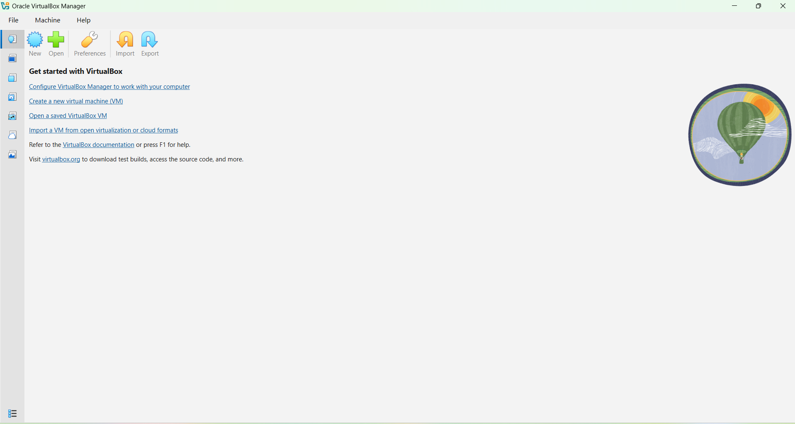
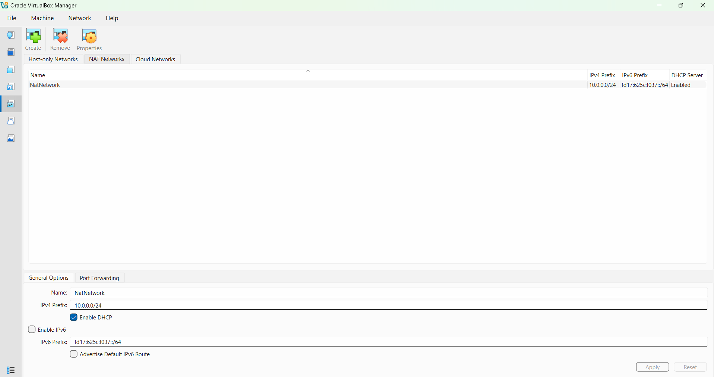
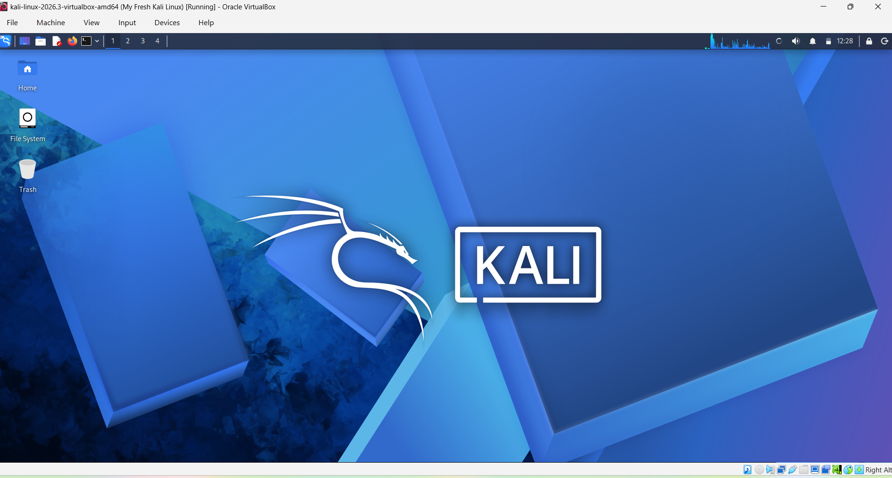
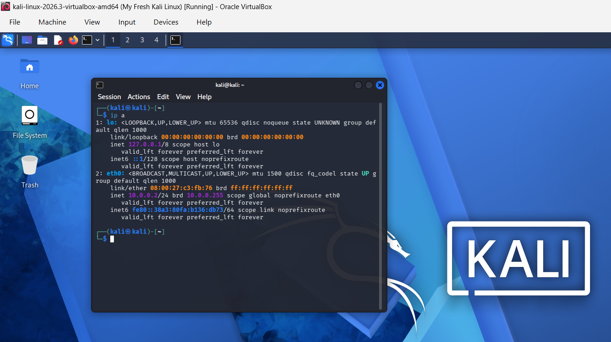
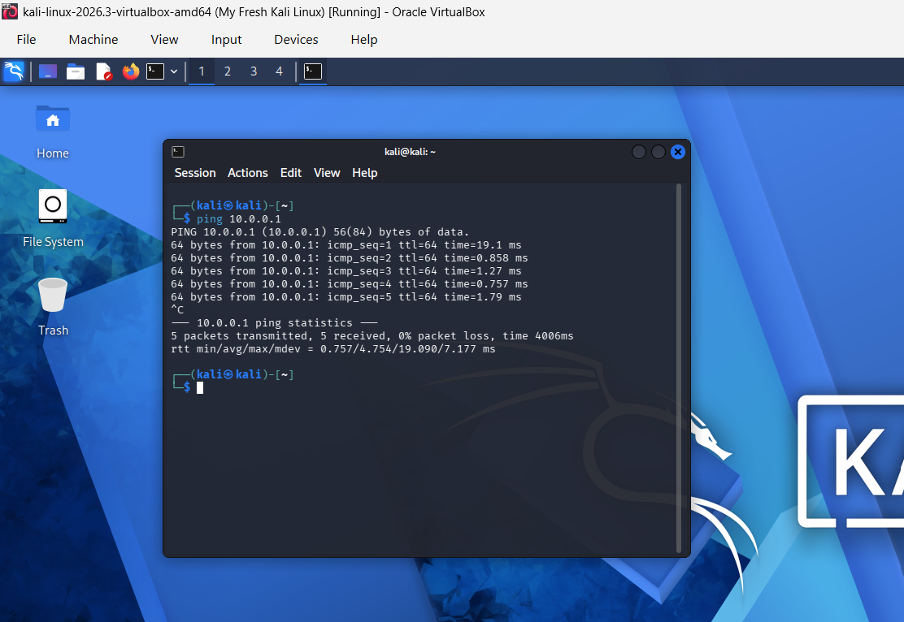
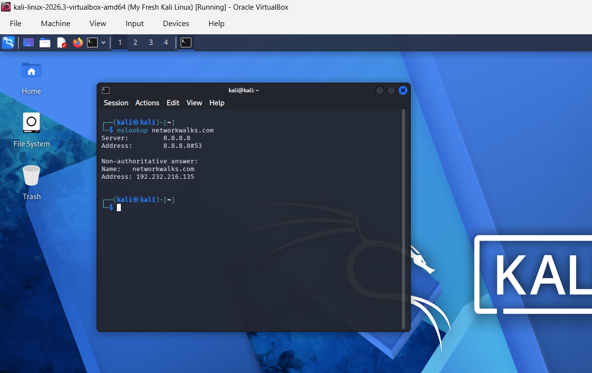
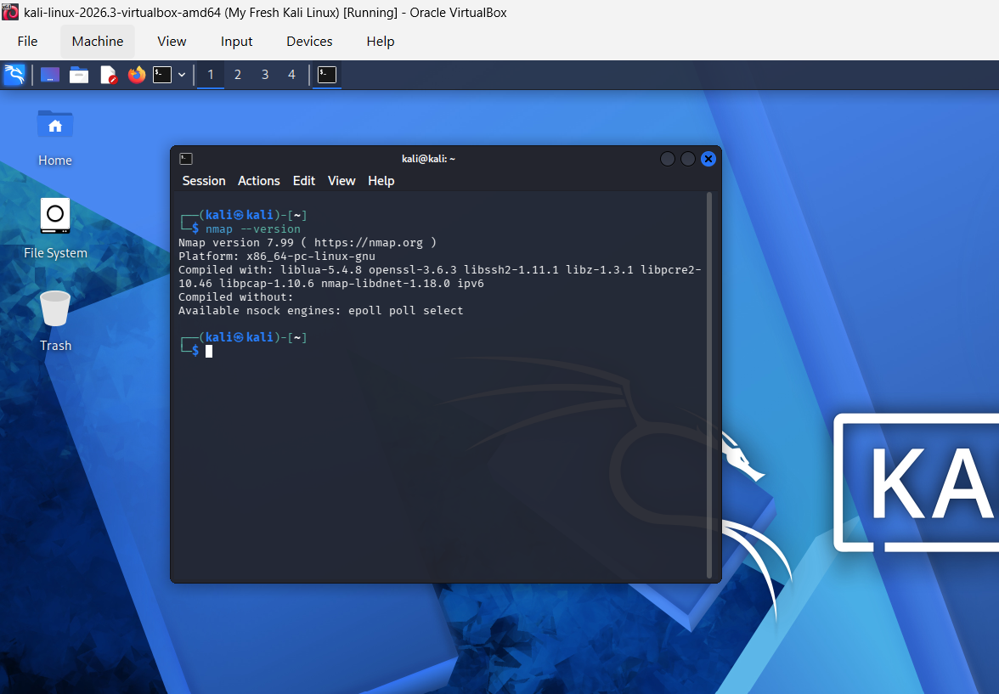

# NETWORKWALKS--SIDDHANTHADITIYAA-B084-WK1-PM1-CYBERSECURITY-LAB-SETUP
# Cybersecurity Lab Environment Setup
### Building an isolated virtual lab for penetration testing and ethical hacking practice

---

## 📌 Project Overview

In this project, I set up a virtual cybersecurity and penetration-testing laboratory using **VirtualBox** and **Kali Linux**.

I configured the lab on a private virtual network (NAT Network) so that I can add more machines later and use them as targets for authorized security testing.

---

## 🎯 Objectives

My objectives for this project were to:

- Install VirtualBox.
- Create a private NAT Network for my lab.
- Import and run Kali Linux as a virtual machine.
- Verify the IP address of my Kali VM.
- Check network connectivity and DNS resolution.
- Verify that Nmap is installed and working.
- Document the complete setup process.

---

## 🛡️ Purpose of the Lab

I built this lab as an isolated and controlled environment for cybersecurity learning and authorized security testing, such as:

- Network reconnaissance
- Port scanning
- Vulnerability assessment
- Packet analysis
- Web security testing
- Security-tool experimentation

> ⚠️ **Important:** I will only use this laboratory on systems that I own or have explicit permission to test. I will not use the lab or its tools to attack unauthorized systems.

---

## ⚙️ Lab Configuration

| 🧩 Component | ⚙️ Configuration |
|---|---|
| 🖥️ Host OS | Windows |
| 🧰 Hypervisor | Oracle VirtualBox |
| 🐉 Security OS | Kali Linux 2026.3 (`kali-linux-2026.3-virtualbox-amd64`) |
| 💽 VM Name | My Fresh Kali Linux |
| 🌐 Virtual Network | NAT Network (`NatNetwork`) |
| 📡 Network Address | 10.0.0.0/24 |
| 🐧 Kali IP Address | 10.0.0.2/24 |
| 🚪 Default Gateway | 10.0.0.1 |
| 🌍 DNS Server | 8.8.8.8 |

---

## 🪜 Lab Setup Procedure

### Step 1. Install VirtualBox
I installed Oracle VirtualBox as my hypervisor. The screenshot below shows VirtualBox Manager ready to use.



### Step 2. Create the NAT Network
I created a dedicated NAT Network in VirtualBox under **NAT Networks**.

**My configuration:**
- Name: `NatNetwork`
- IPv4 Prefix: `10.0.0.0/24`
- DHCP: Enabled
- IPv6: Disabled



I chose a NAT Network because multiple VMs on the same NAT Network can communicate with each other and still have outbound Internet access. This will let me add attacker and target VMs to the lab later.

### Step 3. Import and Start Kali Linux
I imported the Kali Linux VirtualBox image (`kali-linux-2026.3-virtualbox-amd64`) into VirtualBox, connected it to `NatNetwork`, and started the VM. Kali booted successfully to the desktop.



### Step 4. Verify the Kali IP Address
I opened the Kali terminal and checked the IP configuration with `ip a`. The `eth0` interface is `UP` with the address `10.0.0.2/24`.

```bash
ip a
```



---

## 🔎 Lab Verification

| ✅ Test | 🧾 Command | 🎯 Result |
|---|---|---|
| 🌐 Check IP address | `ip a` | `eth0` = 10.0.0.2/24 ✔️ |
| 📡 Test gateway | `ping 10.0.0.1` | 5/5 replies, 0% packet loss ✔️ |
| 🔎 Test DNS resolution | `nslookup networkwalks.com` | Resolved to 192.232.216.135 ✔️ |
| 🧰 Verify Nmap | `nmap --version` | Nmap 7.99 ✔️ |

### 1. Test Gateway Connectivity
I pinged the gateway to confirm that my Kali VM can reach the lab network.

```bash
ping 10.0.0.1
```

I sent 5 packets and received 5 replies with **0% packet loss**, so the gateway is reachable.



### 2. Test DNS Resolution
I tested DNS resolution with `nslookup`.

```bash
nslookup networkwalks.com
```

The domain was resolved through my DNS server `8.8.8.8` and returned `192.232.216.135`.



### 3. Verify Nmap
I checked that Nmap is available on my Kali VM.

```bash
nmap --version
```

Nmap **7.99** is installed and working.


---
## 💡 What I Learned

Through this project, I learned:

- **NAT Network:** how a NAT Network lets multiple VMs talk to each other while still reaching the Internet.
- **VM networking:** how a VirtualBox network adapter attaches a VM to a virtual network.
- **IP configuration:** how to check and verify the IP address, gateway and DNS on Kali Linux.
- **Network testing:** how to use `ping` and `nslookup` to verify connectivity and name resolution.
- **Documentation:** why recording commands, configuration and screenshots matters in a professional cybersecurity project.

---

## 🔐 Security & Ethical Use

I built this laboratory strictly for **educational purposes only**. I will only test systems that I own or have explicit written permission to test.

---

## 🔗 Tools & Resources

- VirtualBox: https://virtualbox.org/wiki/Downloads
- Kali Linux: https://kali.org/get-kali

---

## 👤 Author
**Yuvraj Dharmendra Yadav**\
Third year Computer Engineering student\
Cybersecurity Intern, Networkwalks

LinkedIn: <www.linkedin.com/in/yuvraj-yadav-77205642b>

---

## 📌 Project Information

| | |
|---|---|
| **Program Name** | Cybersecurity at Networkwalks |
| **Week** | 01 |
| **Project** | Cybersecurity & Pentesting Lab Setup |
| **Repository** | GitHub |
